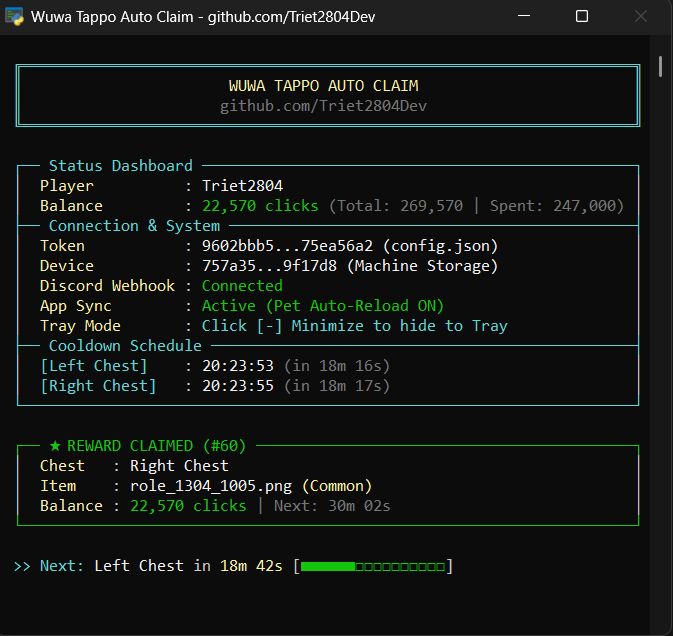
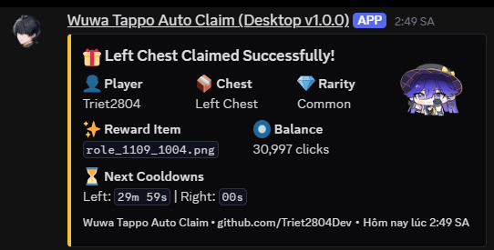
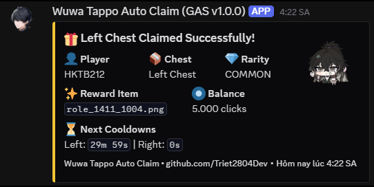

# Wuwa Tappo Auto Claim

An automated chest claimer for the Wuwa Tappo App, so you don't have to keep track of countdown timers manually.

Available in two versions:
- **Desktop**: Runs in the background from your system tray, extracts tokens automatically from the official launcher.
- **Cloud (Google Apps Script)**: Runs 24/7 on Google Cloud via time-driven triggers, no PC required.

[](LICENSE)
[](https://github.com/Triet2804Dev/Wuwa-Tappo-Auto-Claim/releases)
[](https://github.com/Triet2804Dev/Wuwa-Tappo-Auto-Claim/stargazers)

## Preview

<p align="center">
  
</p>

<p align="center">
  
  
</p>

## Features

### Desktop
- Automatically extracts token/cookie from the launcher, no manual packet capture needed.
- System tray integration with console toggle and optional auto-start on Windows boot.

### Cloud (GAS)
- 24/7 cloud automation without needing your PC powered on.

### General Features
- **100% API-Driven**: Both versions operate purely via API requests; the game launcher does not need to remain open while claiming.
- **Smart Click Maintenance**: Automatically syncs your current balance and adds +1,000 clicks before opening, ensuring chest claims cost you net zero clicks.
- **Zero-Overhead Intervals**: Pre-calculates exact claim times with zero network requests sent during cooldown periods.
- **Discord Webhook Notifications** *(Optional)*: Notifies you of reward breakdown, pet level stats, and connection errors.

## Installation & Usage

### For Desktop

#### Pre-built .exe (Recommended for Users)

1. Download `WuwaTappoAutoClaim.exe` from [Releases](https://github.com/Triet2804Dev/Wuwa-Tappo-Auto-Claim/releases).
2. Open the official game launcher and log in at least once so the token exists.
3. Run the executable. It will auto-detect your token, generate `config.json`, and minimize to the system tray.

#### Running from Source (For Developers)

Requires Python 3.10 or higher.

```bash
git clone https://github.com/Triet2804Dev/Wuwa-Tappo-Auto-Claim.git
cd Wuwa-Tappo-Auto-Claim
python -m venv venv
.\venv\Scripts\activate
pip install -r requirements.txt
python auto_claim.py
```

- Or simply run `run.bat` (automatically installs dependencies).
- To build the `.exe` yourself: run `build.bat`, output will be in `dist/WuwaTappoAutoClaim.exe`.

#### Configuration

The application automatically creates `config.json` on its first run:

```json
{
  "cid": "",
  "token": "",
  "discord_webhook": "",
  "show_window": true,
  "start_with_windows": false
}
```

- `discord_webhook`: (Optional) Paste your Discord webhook URL to receive claim notifications.
- `show_window`: Set to `true` to keep the console window visible, or `false` to run quietly in the tray.
- `start_with_windows`: Set to `true` to start automatically when Windows boots.
- You can also toggle window visibility or autostart directly by right-clicking the system tray icon.

### For Cloud (Google Apps Script)

Runs 24/7 on Google Cloud via triggers without keeping your PC powered on.

See the setup guide: [google-script/README.md](google-script/README.md)

## Notes & Disclaimer

- This is an unofficial tool and is not affiliated with Kuro Games. Use at your own risk.
- It is not recommended to keep the Wuwa Tappo App open on Desktop while the Cloud version is actively claiming, as this may cause state desynchronization. If you run into errors, restart the Wuwa Tappo App.
- If your token expires:
  - Desktop: Re-open the game launcher to auto-refresh the token.
  - Cloud: Obtain a new token and update `CONFIG.TOKEN`.
- Found a bug? Open an [Issue](https://github.com/Triet2804Dev/Wuwa-Tappo-Auto-Claim/issues) with your console logs.

## Show Your Support

If this tool saved you time and kept your chests claimed, please consider giving it a Star! Thank you!

## License

Distributed under the [MIT License](LICENSE).
