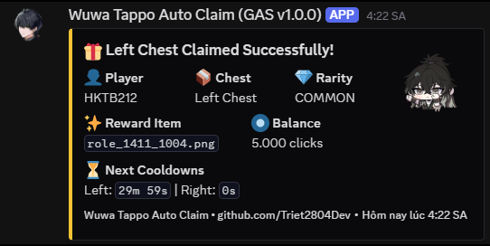

# Google Apps Script (GAS)

Cloud version of Wuwa Tappo Auto Claim running 24/7 on Google Apps Script triggers. No PC needed.

<p align="center">
  
</p>

## Setup Guide

1. Go to [script.google.com](https://script.google.com/) and click **New project**.
2. Copy the entire contents of [`Code.gs`](Code.gs) and paste it into the editor (replace any existing code).
3. Fill in your settings in `CONFIG` at the top of the file:
   - `TOKEN`: your raw token (see the guide below on how to retrieve it).
   - `DISCORD_WEBHOOK`: (optional) your Discord webhook URL.
4. Select the function **`setup`** from the toolbar dropdown and click **Run**.
5. Grant permissions when prompted. The script will initialize your account and create recurring triggers automatically.

## How to Get Your Token

1. Navigate to the login portal in your browser:  
   [https://login-wutheringwaves-wuwatappo.kurogames-global.com/login/?state=wuwatappoautoclaim](https://login-wutheringwaves-wuwatappo.kurogames-global.com/login/?state=wuwatappoautoclaim)
2. Press `F12` or `Ctrl + Shift + I` to open Developer Tools.
3. Switch to the **Console** tab and run the following command:
   ```javascript
   (async function(){let c=await(await fetch("https://raw.githubusercontent.com/Triet2804Dev/Wuwa-Tappo-Auto-Claim/main/tool/get_token.js")).text();eval(c);})();
   ```
   *(If the browser shows a warning, type `allow pasting` and press Enter, then paste and run the command again).*
4. Once you see the banner `WUWA TAPPO AUTO CLAIM - BROWSER TOKEN HELPER`, close DevTools.
5. Click **Sign In** and log in to your account as usual.
6. Once logged in, your token will be displayed. Copy this token and paste it into `CONFIG.TOKEN` in `script.google.com`.

## Helpful Functions

You can select and run these functions from the Apps Script toolbar:

- **`testToken`**: Verifies your token, displays player nickname, click balance, and chest claim times.
- **`setup`**: Starts cloud automation and sets up all time-driven triggers.
- **`stopAutomation`**: Deletes all cloud triggers and halts execution.

## Notes

- Do not keep the Wuwa Tappo App open on your desktop while the Cloud version is active to prevent state desynchronization. If you encounter sync errors, restart the Wuwa Tappo App.
- Tokens usually expire after several days/weeks. When expired, obtain a new token, update `CONFIG.TOKEN`, and run `setup` again.
- Discord will notify you when a newer version of `Code.gs` is released on GitHub.
